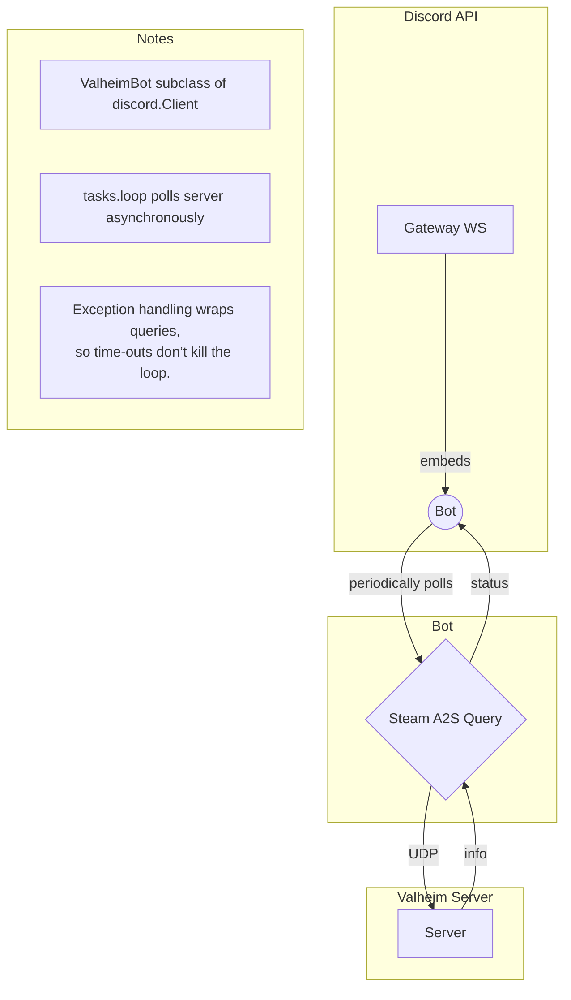

# Valheim‑Discord‑Bot

A **zero‑spam Discord bot** that keeps your community informed of your Valheim dedicated server’s status in *one live‑updating embed*.  
It uses the Steam A2S protocol to poll your server, then updates a single message in the channel you choose—no flooding, no rate‑limit issues.

---

## ✨ Key Features
| Feature | Details |
|---------|---------|
| ✅ **Live player count** | Shows `current / max` players online. |
| ✅ **Online / offline detection** | Gracefully handles time‑outs, firewall issues or server restarts. |
| ✅ **Single‑message update** | Edits one persistent embed instead of posting new messages. |
| ✅ **Runs everywhere** | Pure Python 3.9+ & asynchronous; works on Windows, Linux, macOS, ARM (Raspberry Pi). |
| ✅ **Ultra‑small container** | Multi‑stage build → final image ≈ 50 MB using Distroless Python. |
| ✅ **Security‑hardened** | Non‑root user, read‑only filesystem, no shell or package manager in runtime layer. |

---

## 📂 Repository Layout

```text
valheim-discord-bot/
├─ src/
│  └─ bot.py                # main application (async Discord client)
├─ test/
│  └─ test_bot_pytest.py    # pytest tests (bot + health server)
├─ requirements.txt          # pinned dependencies
├─ requirements-test.txt     # test dependencies
├─ pyproject.toml          # pytest, coverage, lint configuration
├─ Dockerfile               # multi‑stage, distroless build
├─ .dockerignore            # ignore cache, VCS, secrets
└─ README.md                # you are here
```

> **Secrets** (`.env`) are **NOT** committed—add the file locally or inject vars in your CI / orchestration platform.

---

## ⚙️ How It Works

1. `python‑a2s` sends an `A2S_INFO` query to **`VALHEIM_HOST:VALHEIM_QUERY_PORT`** (the *game port + 1*).  
2. The response contains `player_count`, `max_players`, and the server name.  
3. The bot formats an embed (`🟢 Online – X/Y players` **or** `🔴 Offline`) and edits **one** message whose ID you supply.  
4. A background task runs every `UPDATE_PERIOD` seconds.

### A2S vs RCON  
Valheim’s built‑in A2S support is read‑only but more firewall‑friendly than RCON and does not require an admin password.

---

## 🚀 Quick Start

```bash
# 1) Clone
git clone https://github.com/your‑org/valheim-discord-bot.git
cd valheim-discord-bot

# 2) Create a Discord bot application and invite it to your server
#    (Bot permission, no privileged intents needed)

# 3) Copy .env.sample → .env and fill in the blanks
cp .env.sample .env
$EDITOR .env

# 4) Build & run with Docker
docker build -t valheim-bot .
docker run --env-file .env --restart unless-stopped valheim-bot
```

The embed in the target channel will update within a minute.

---

## 📝 Environment Variables

| Variable | Required | Example | Notes |
|----------|----------|---------|-------|
| `DISCORD_TOKEN` | ✅ | `NzEy...` | **Bot token** from the Discord developer portal. |
| `DISCORD_CHANNEL_ID` | ✅ | `123456789012345678` | Channel where the message lives. |
| `DISCORD_MESSAGE_ID` | ✅ | `987654321098765432` | ID of the placeholder message the bot will edit. |
| `VALHEIM_HOST` | ✅ | `203.0.113.42` or `valheim.example.com` | Public IP / DNS of the game server. |
| `VALHEIM_QUERY_PORT` | ✅ | `2457` | Usually *game‑port + 1*. If you host on `2456`, use `2457`. |
| `UPDATE_PERIOD` | ❌ | `60` | Seconds between queries (default = 60). |

> **How to get IDs?**  
> In Discord, enable **Developer Mode** → right‑click the channel/message → **Copy ID**.

---

## 🐋 Running with Docker

### Build

```bash
docker build -t valheim-discord-bot:0.1 .
```

### Run

```bash
docker run \
  --env-file .env \
  --name valheim-bot \
  --restart unless-stopped \
  --read-only \
  --cap-drop ALL \
  valheim-discord-bot:0.1
```

#### Why Distroless?

* **Tiny attack surface** – no shell, package manager, or other utilities.  
* **Smaller pulls** – ~50 MB image speeds up CI/CD and edge deployments.  
* **Multi‑arch** – the base image ships manifests for `amd64`, `arm64`, `arm/v7`.

---

## 🖥️ Local Development

```bash
python -m venv .venv
source .venv/bin/activate
pip install -r requirements.txt
python bot.py
```

Logs stream to stdout; use `CTRL‑C` to stop.

### 🧪 Testing

The project includes comprehensive unit tests with 100% code coverage:

```bash
# Install test dependencies
pip install -r requirements-test.txt

# Run all tests (coverage of src/bot.py and src/health.py must be 100%)
pytest
```

**Test Coverage:**
- ✅ Bot initialization and configuration
- ✅ Environment variable handling
- ✅ Server status polling (online/offline scenarios)
- ✅ Discord message editing
- ✅ Exception handling and error recovery
- ✅ Async task management
- ✅ Edge cases and error conditions

The tests use mocking to avoid external dependencies and ensure reliable, fast execution.

### 🚀 Continuous Integration

The project includes GitHub Actions workflows for automated testing:

- **`.github/workflows/test.yml`** - Basic test workflow (recommended for most users)
- **`.github/workflows/ci.yml`** - Comprehensive CI with linting, security checks, and Docker testing
- **`.github/workflows/tests.yml`** - Simple test workflow

**Features:**
- ✅ Multi-Python version testing (3.9, 3.10, 3.11, 3.12)
- ✅ Code coverage reporting
- ✅ Linting with black, isort, mypy
- ✅ Security scanning with bandit and safety
- ✅ Docker image testing
- ✅ Cached dependencies for faster builds

**Status Badge:**
```markdown

```

### 🛠️ Local Development

For local development, you can run all checks using the provided scripts:

```bash
# Using the bash script
./scripts/dev.sh

# Using the Python script
python scripts/dev.py
```

**Development Tools:**
- **Code Formatting**: `black src/ test/`
- **Import Sorting**: `isort src/ test/`
- **Linting**: `ruff check src/ test/`
- **Type Checking**: `mypy src/ --ignore-missing-imports`
- **Security Scanning**: `bandit -r src/`
- **Vulnerability Check**: `safety check`

---

## 💡 Advanced Deployment

### Docker Compose

```yaml
version: "3.9"
services:
  valheim-bot:
    build: .
    env_file: .env
    read_only: true
    restart: unless-stopped
```

### Kubernetes (K8s)

A minimal Deployment/Secret example is provided in `k8s/`.  
Patch `VALHEIM_HOST`, `VALHEIM_QUERY_PORT`, and mount your secret.

### systemd Service

Install the container with **Podman** or **Docker** and drop `valheim-bot.service`:

```ini
[Unit]
Description=Valheim Discord Bot
After=network.target

[Service]
Restart=always
EnvironmentFile=/opt/valheim-bot/.env
ExecStart=/usr/bin/docker run --rm --env-file /opt/valheim-bot/.env valheim-discord-bot:0.1
ExecStop=/usr/bin/docker stop valheim-bot

[Install]
WantedBy=multi-user.target
```

---

## 🛠️ Troubleshooting

| Symptom | Possible Cause | Fix |
|---------|----------------|-----|
| Embed shows **Offline** even though server is up | Wrong `VALHEIM_QUERY_PORT`; firewall blocking UDP | Verify port (game port + 1), open UDP 2457. |
| `bot.py` crashes with `Privileged intent required` | You enabled member‑list code | The bot does **not** need privileged intents—leave them disabled. |
| High update latency | Low `UPDATE_PERIOD` + Discord rate‑limit | `UPDATE_PERIOD ≥ 30 s` is safe. |

---

## 🧱 Code Overview



---

## 🤝 Contributing

1. Fork the repo and create your feature branch (`git checkout -b feature/foo`).
2. Commit your changes with clear messages.
3. Run `pre-commit run --all-files` to satisfy linting/formatting.
4. Push to the branch and open a Pull Request.

Bug reports and feature requests are welcome via GitHub Issues.

---

## 🛡️ Security

* Runs as UID `65532` (`nonroot`) inside a **read‑only** filesystem.  
* Use a **new Discord token** with only the minimal bot scope.  
* Keep the image up‑to‑date: `docker build --pull --no-cache -t valheim-bot:latest .`

---

## 📜 License

This project is licensed under the **MIT License**—see [`LICENSE`](LICENSE) for details.

---

## 🙏 Acknowledgements

* [discord.py](https://github.com/Rapptz/discord.py) – the gold standard for Python Discord bots.  
* [python‑a2s](https://github.com/Barbosik/python-a2s) – simple Steam A2S client.  
* Google **Distroless** images for secure and minimal production containers.

Happy hunting, and may your Vikings always know when the mead hall is bustling!